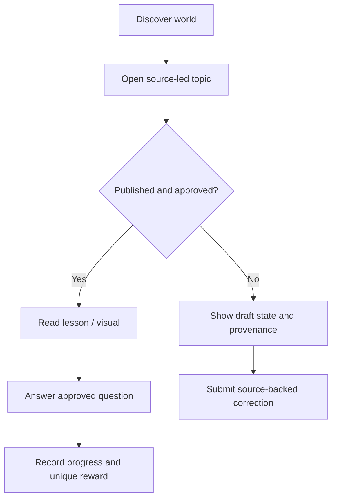

# Route Inventory and Journey Specifications

**Purpose:** establish navigation and page state expectations. **Status:** current routes inspected; target routes proposed.

## Existing route groups

| Group | Routes | Access | Required states |
|---|---|---|---|
| Discovery | `/`, `/explore`, `/worlds/:slug`, `/worlds/:slug/chapters/:n`, `/search` | visitor | loading, empty, 404, source-state label |
| Content | `/archive/:id`, `/library`, `/infographic/:id`, `/verify/:id`, `/quran/:n`, `/tafsir/:n`, `/mosques/:slug` | visitor/reviewer by data sensitivity | restricted-draft state, invalid ID, source missing |
| Learning | `/start`, `/tracks/:slug`, `/game`, `/dashboard`, `/kids`, `/family` | mixed | signed-out, question expired, already rewarded |
| Trust | `/methodology`, `/support`, `/privacy`, `/terms`, `/accessibility`, `/institutions`, `/pricing`, `/rewards` | visitor | clear pilot/disabled status |
| Editorial | `/admin`, `/admin/infographics`, `/admin/corrections` | reviewer | forbidden, empty queue, save failure, audit receipt |

## Major journeys

### JOURNEY-01: Learner first value

1. Visitor opens `/explore`, chooses a world, and sees only titles/provenance for drafts.
2. Learner opens an approved lesson when available; source and review version are shown.
3. Signed-in learner answers an approved question. API consumes one signed token; transaction writes attempt and unique ledger record.
4. If the question is not approved, it is excluded from the public serving pool.

### JOURNEY-02: Correction recovery

A signed-in reader opens `/corrections/:id`, provides a minimum-length explanation and optional valid HTTP(S) source, gets a receipt, and cannot alter content. Reviewer sees the report, creates a review/revision, then records resolution. Public status changes only after separate release authorization.

### PAGE-SUPPORT

Goal: route technical/account/content problems. Current implementation gives contextual routes and explicitly states that a staffed support channel/SLA is still a release dependency. Before public launch: add a secure support ticket entity, category, owner, status, and response workflow.
