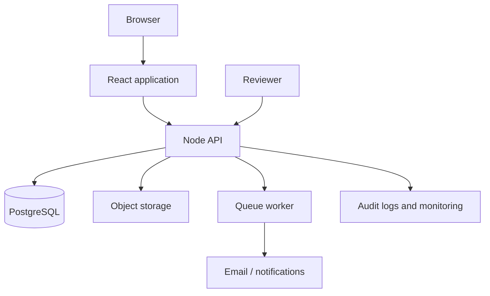
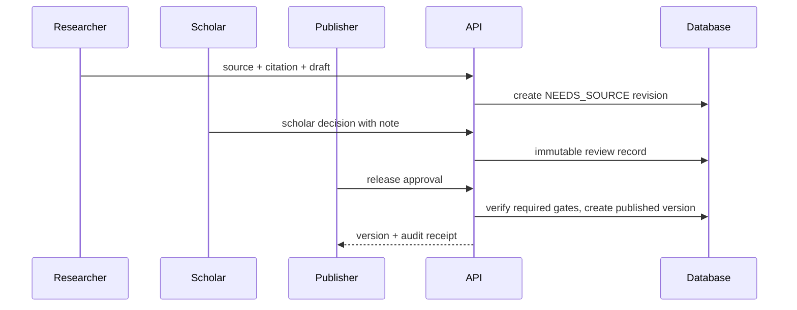

# Architecture, Data, and API Contracts

**Purpose:** define current boundaries and target implementation. **Status:** target design; current pilot remains Workers/D1.

## Architecture decision

Current: React/Vinext application on Sites Workers, D1, ChatGPT identity. Target public launch: React frontend plus Node.js modular monolith on AWS EC2 or ECS; PostgreSQL as system of record; object storage for visual assets; Redis only when real cache/queue pressure is measured. The target avoids microservices until a bounded operational reason exists.

## Core data model

`User 1..* Progress`, `User 1..* Bookmark`, `User 1..* QuizAttempt`, `User 1..* PointLedger`; `ContentItem 1..* Citation/Revision/Review/Translation`; `ContentItem 1..* InfographicVersion`; `CorrectionReport -> ContentItem`; `Partner 1..* Reward -> Redemption`.

Add to the current schema before public launch: `content_release_approvals`, `infographic_versions`, `correction_reports` (rather than generic audit payload only), `support_tickets`, `consent_records`, `guardian_relationships`, `organizations`, `organization_memberships`, `subscriptions`, `payment_events`, `outbox_events`.

## API conventions

Use `/api/v1`, JSON UTF-8, ISO-8601 UTC timestamps, cursor pagination, request ID, `{error:{code,message,requestId}}` failures, and server-enforced role/resource checks. Keep raw draft text reviewer-only.

| API | Contract | Auth | P0 rule |
|---|---|---|---|
| GET `/v1/content/:id` | public safe projection | optional | never returns draft body without reviewer permission |
| POST `/v1/corrections` | creates correction report | signed-in | rate limit + source URL validation |
| POST `/v1/reviews` | records review decision | reviewer | does not publish |
| POST `/v1/releases` | records release approval | publisher + scholar gate | idempotency key + audit event |
| GET `/v1/questions/next` | serves eligible question | signed-in | approved question only, expiring token |
| POST `/v1/questions/:id/answer` | scores one token | signed-in | transactional single-use/unique award |
| GET `/v1/me/export` | exports owned data | signed-in | asynchronous, verified requester |
| DELETE `/v1/me` | initiates deletion | signed-in | retention/exception workflow |

## Critical sequence: publication

