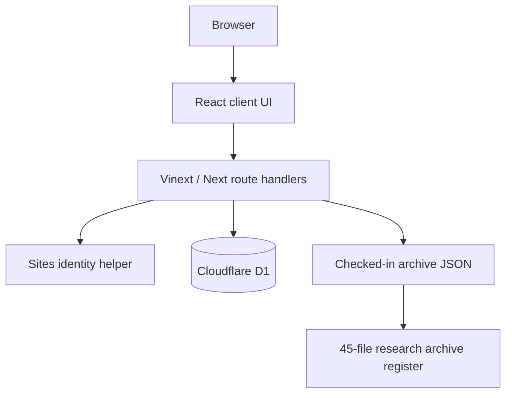

# NOOR AL-ILM — Complete Project Audit

**Audit date:** 2026-10-27  
**Audited revision:** `e5f4215`  
**Scope:** source code, database schema/migrations, checked-in research data, project documentation, dependency manifest, and Git configuration.  
**Change policy:** this audit adds this document only. It does not change the site UI, routes, content, database, deployment, or behavior.

---

## 1. Executive assessment

NOOR AL-ILM is a private, Arabic-first Islamic learning **pilot** built with React/TypeScript on Vinext/Sites Workers and Cloudflare D1. It already contains a substantial interactive front end, a structured research archive, a reviewer-gated draft workflow, a signed-in learning trial with a protected point ledger, and a visual infographic draft system.

The project is **not yet a public production education platform**. Its main blocker is not visual design: it is the deliberate absence of approved religious content, a public-release workflow, independent authentication/account lifecycle, child/family protection, payment/reward operations, production AWS/PostgreSQL infrastructure, and production QA/operations.

### Verified inventory

| Area | Verified count / state |
|---|---:|
| Tracked project files | 185 |
| Learning worlds | 16 |
| Chapter routes generated from worlds | 48 |
| Research source files indexed | 45 |
| Extracted research candidates | 3,337 |
| Quran navigation routes | 114 surah routes + tafsir aliases |
| Mosque records | 6 research-stage records |
| Learning tracks | 3 |
| Direct application API routes | 11 |
| D1 tables in schema | 16 |
| Drizzle migrations | 3 |
| Trial questions | 16 |
| Direct Git remotes configured | 0 |

### Status legend

- **Functional**: implemented in code and connected to current runtime data/API.
- **Partial**: a navigable or persisted foundation exists, but required production behavior or approved content is absent.
- **UI / proposal**: rendered interface or specification only; no business operation behind it.
- **Missing**: no implementation found in the audited source.
- **Blocked by governance**: intentionally not enabled until source, rights, scholarly, legal, or partner requirements are complete.

---

## 2. Current architecture and repository boundaries

### 2.1 Implemented runtime

| Layer | Current implementation | Status |
|---|---|---|
| UI | React 19 + TypeScript in `components/`, one catch-all route dispatcher | Functional |
| Framework/runtime | Next 16 / Vinext / Vite / Sites Workers | Functional private pilot |
| Identity | `app/chatgpt-auth.ts` reads Sites visitor identity | Functional only within the Sites host |
| Authorization | Reviewer allowlist through `REVIEWER_EMAILS` or `REVIEWER_IDS` | Partial; coarse reviewer role only |
| Database | Cloudflare D1 / SQLite schema through Drizzle | Functional for implemented flows |
| Research index | `data/archive-records.json`, `archive-summaries.json`, `source-topics.json` | Functional research catalog |
| Content publishing | Review records can be stored, but automatic publication is intentionally disabled | Blocked by governance |
| Hosting | private Sites deployment | Functional private pilot |
| AWS / PostgreSQL | documentation only in `DEPLOY_AWS.md` | Missing implementation |

### 2.2 Repository structure

| Path | Responsibility |
|---|---|
| `app/` | root layout, catch-all page dispatch, server API routes, authentication bridge, global CSS |
| `components/` | learner, research, visual, editor, trust and reusable UI components |
| `components/ui/` | installed shadcn/Base UI component set; most are available primitives rather than product-specific screens |
| `lib/` | worlds, chapter guides, Quran index, trial quiz bank, helper functions, Sites connector support |
| `data/` | derived archive search data and topic index |
| `research/` | original archive ZIP, inventories, claim audit, coverage matrix and editorial notes |
| `db/` | Drizzle D1 schema and database client |
| `drizzle/` | three SQL migrations and snapshots |
| `worker/` | Worker entrypoint and connector preview binding |
| `BLUEPRINT_NOOR_AL_ILM/` | execution blueprint, target architecture, gap plan and release backlog |
| root Markdown files | operational policies, requirements, QA, licenses, deployment and institutional pack |

### 2.3 Source-of-truth warning

The 3,337 archive records are research inputs. They are not approved religious lessons, fatwas, verified historical facts, or public curriculum. The current source protects this distinction through draft labels, reviewer permissions, and a disabled publication path. That boundary must remain in place during future development.

---

## 3. Front-end page and route inventory

All displayed pages are dispatched by `components/experience.tsx` from the App Router catch-all route `app/[...slug]/page.tsx`. The route table below covers actual conditions in that dispatcher, including aliases.

### 3.1 Public and learner routes

| Route pattern | Page/component | State | What works now | Remaining gap |
|---|---|---|---|---|
| `/` | home | Functional | brand, navigation, theme and discovery sections | no approved lessons surfaced |
| `/explore` | world index | Functional | searches 16 world cards client-side | no curriculum/filter by learner level |
| `/worlds/:slug` | `WorldLanding` | Partial | 16 world landing pages, chapter cards, archive catalog | chapter content is draft catalog, not lessons |
| `/worlds/:slug/chapters/:number` | `ChapterPage` | Partial | 48 generated chapters with guide question, filtered archive rows | no approved chapter lesson, completion or assessment |
| `/search` | `SearchPage` | Functional research search | server-backed pagination, world and text filters | no semantic search, approved-content filter or saved searches |
| `/archive/:id` | `ArchiveDetail` | Partial | provenance, draft warning, save/read controls, correction entry point | raw draft prose exposure is reviewer-sensitive; no citations/review state per claim rendered |
| `/quran` | `QuranIndex` | Partial | all 114 surah names, search and internal navigation | no hosted Quran text, tafsir or translations |
| `/quran/:number` | `SurahDetail` | Partial | valid 1–114 detail shell and external Quran.com links | no licensed Arabic text/tafsir/translation import |
| `/tafsir` | Quran index alias | Partial | opens Quran index | no tafsir catalogue inside platform |
| `/tafsir/:number` | surah detail alias | Partial | source links to Quran.com tafsir | no internal tafsir content |
| `/library` | `VisualLibrary` | Functional draft system | filters/paginates infographic candidates; opens visual and verification views | no approved religious infographic collection or production exports |
| `/infographic/:id` | `VisualDetail` | Partial | dynamic visual template, sequence, QR, source and draft state | no approved version workflow or image/PDF export pipeline |
| `/verify/:id` | `VisualDetail` in verification mode | Partial | stable verification page/QR target for draft candidates | review/version evidence is not a public release certificate |
| `/mosques` | `MosqueIndex` | Partial | six real mosque discovery records | no map, timeline, photos, verified architectural facts or source-driven filters |
| `/mosques/:slug` | `MosqueDetail` | Partial | local record plus matching archive research rows | historical/location details remain intentionally unfilled |
| `/start`, `/tracks` | `TrackIndex` | Functional navigation | three curated exploration tracks | tracks have no progress/completion curriculum model |
| `/tracks/:slug` | `TrackDetail` | Partial | beginner, family and researcher paths link into worlds | no personalized sequencing, approval gate or completion state |
| `/game`, `/challenges` | `KnowledgeGame` | Functional internal trial | signed-in question serving, answer submission, one-coin unique award | no real challenge scheduler, approved bank administration, matching/ordering interaction UI, or public curriculum status |
| `/dashboard` | `LearnerDashboard` | Partial | signed-in coin, correct count, read and saved data | no full course progress, achievements, family views, notifications or settings |
| `/methodology`, `/sources` | methodology page | Functional information page | editorial process and source boundary explained | no browsable citation catalogue / source license registry UI |
| `/kids`, `/family` | child/family preview | UI / proposal | safety position and link to children world | no child profile, guardian consent, age gating or family dashboard |
| `/pricing` | pricing page | UI / proposal | free/premium/institutional plan proposal and 90-day trial proposal | no checkout, entitlement, taxes, invoices or trial state |
| `/rewards` | rewards page | UI / disabled | clearly states no active redemptions | no partner offers, coupons, inventory, fraud controls or redemption flow |
| `/institutions` | institutional information page | Partial | explains review and collaboration readiness | no organization workspace, institutional SSO, export/report UI or formal workflow |
| `/support` | support page | Partial | directs users to current research/account routes and states pilot limit | no persisted support ticket, SLA, support inbox or notification workflow |
| `/privacy` | privacy page | Information draft | current pilot data handling described | no legal approval, self-service export/delete or consent centre |
| `/terms` | terms page | Information draft | current pilot usage boundary described | no legally approved, jurisdiction-ready terms |
| `/accessibility` | accessibility page | Information draft | current accessibility intentions and limitations | no accessibility conformance audit or VPAT-style evidence |
| unmatched path | `Missing` | Functional | in-app not-found view | no route-level `not-found.tsx` / HTTP 404 behavior verified |

### 3.2 Editorial and moderation routes

| Route pattern | Page/component | State | What works now | Remaining gap |
|---|---|---|---|---|
| `/admin` | `Editorial` | Partial, reviewer-gated | import status, draft review history and review decision entry | only one coarse reviewer role; publication intentionally unavailable |
| `/admin/infographics` | `VisualProductionQueue` | Partial, reviewer-gated | first-200 candidate queue, world/decision filtering, visual preview | no designer assignment, asset production, final QA or public release |
| `/admin/corrections` | `CorrectionInbox` | Partial, reviewer-gated | reads correction reports stored as audit events | no report status, assignee, reply, resolution or public correction notice |
| `/corrections/:id` | `CorrectionForm` | Partial, signed-in | creates a source-backed report with daily throttle | no status tracking for reporter, attachment support or moderation lifecycle |

### 3.3 Authentication routes: actual state

There are **no project-owned `/login`, `/register`, `/forgot-password`, `/verify-email`, `/logout`, or account settings pages**. UI buttons direct users to the hosting-provided `/signin-with-chatgpt` endpoint with `return_to`. `app/chatgpt-auth.ts` only reads the visitor identity supplied by the Sites runtime.

For a GitHub/AWS/self-hosted continuation, this must be replaced or wrapped with an independent authentication implementation before relying on dashboard, coins, bookmarks, correction reports, or editorial roles.

---

## 4. Features and component inventory

### 4.1 Built and connected features

| Feature | Primary code | State | Backend connection |
|---|---|---|---|
| Arabic-first visual identity | `experience.tsx`, `globals.css` | Functional | none required |
| Light/dark preference | `Experience` | Functional | browser `localStorage` |
| Locale selector | `AppHeader` | UI state only | browser `localStorage`; Arabic content remains rendered |
| 16-world discovery | `lib/worlds.ts`, `learning.tsx` | Functional navigation | archive API |
| 48 chapter pages | `WorldLanding`, `ChapterPage` | Partial | archive API filtering |
| archive search/filter/pagination | `SearchPage`, `CatalogRows` | Functional | `GET /api/archive` |
| provenance display | `ArchiveDetail` | Partial | `GET /api/archive?id=` |
| bookmark/read actions | `ArchiveDetail`, dashboard | Functional for signed-in users | `GET/POST /api/user-content` |
| Quran navigation | `scripture.tsx`, `lib/quran.ts` | Partial | external Quran.com links only |
| mosque research discovery | `places-tracks.tsx` | Partial | archive API |
| visual card and QR draft system | `visual-library.tsx`, `qrcode.react` | Functional draft preview | archive API |
| quiz selection / answer flow | `game-page.tsx`, `lib/quiz-bank.ts` | Functional trial | quiz API and D1 ledger |
| duplicate coin prevention | quiz route + DB unique index | Functional | D1 atomic `INSERT OR IGNORE` unique ledger constraint |
| user dashboard | `dashboard-page.tsx` | Partial | `/api/me`, `/api/user-content` |
| reviewer draft import | `editorial.tsx` | Functional if reviewer + D1 configured | `/api/admin/import` |
| revision/edit/restore | `editor-panel.tsx` | Functional if reviewer + imported item | `/api/admin/content` |
| reviewer decisions | `editorial.tsx` | Functional recording only | `/api/admin/review` + audit event |
| corrections intake | `corrections.tsx` | Functional signed-in intake | `/api/corrections` + audit event |
| policy/trust pages | `trust-pages.tsx` | Functional static pages | none |

### 4.2 Components present but not product-complete

| Component area | Current result | Missing product behavior |
|---|---|---|
| `dashboard-page.tsx` | current coin/balance, read and bookmarks summaries | lessons, enrollments, streaks, goal settings, achievements, recommendation engine, profile controls |
| `game-page.tsx` | choice and true/false rendering visible in UI | proper ordering and matching mechanics despite data types appearing in the trial bank; challenge calendar and rewards |
| `editor-panel.tsx` | editor/revision restore component | full content form, citations, translation, rights, asset and release panels |
| `editorial.tsx` | batch import and review record UI | role-specific queues, release gate, assignment, source verification and outcomes |
| `visual-production-queue.tsx` | queue for 200 candidates | real asset pipeline, exported deliverables, status handoffs, designer QA |
| `corrections.tsx` | submit/list basic reports | durable correction entity, lifecycle status, reporter communication and transparent correction log |
| `trust-pages.tsx` | pilot guidance pages | legal approval/versioning, DSR forms and operational service ownership |
| `components/ui/` | generic UI library inventory | these primitives do not equal implemented platform screens; only components imported into product files are active |

### 4.3 Explicitly missing feature areas

- Independent login, registration, passwordless/password recovery, session management and account deletion.
- User profile, preferences, notification settings, device/session management and data export.
- Family account, guardian relationship, consent evidence, child age gates and child-safe content controls.
- Approved lesson renderer with granular content state, citations, rights, translations and final release version.
- Scholar, researcher, fact-checker, translator, designer, publisher, support and system-admin roles.
- Official Quran/tafsir/hadith data ingestion and licensing workflow.
- Full multilingual UI/content delivery, locale URLs, RTL/LTR per locale and `hreflang`.
- Live payment, subscription, entitlement, invoicing, tax, cancellation/refund and webhook reconciliation.
- Partner/coupon/reward redemption, inventory locking, fraud review and delivery confirmation.
- Institutional multi-tenant accounts, memberships, SSO, reporting and organization administration.
- Notifications, email delivery, support system, audit exports, observability and incident response.
- Automated test suite, CI workflow, security scanning, runtime monitoring, load testing and backup restoration proof.

---

## 5. Backend API inventory

### 5.1 Implemented routes

| Method and route | Auth | Actual behavior | State / limit |
|---|---|---|---|
| `GET /api/archive` | public; draft text restricted by role | list/search/filter archive candidates or retrieve one record | Functional research API; no versioned public content API |
| `GET /api/me` | Sites signed-in identity | returns profile name, coins, correct count and challenge-style counters | Partial; no complete account profile |
| `GET /api/user-content` | signed-in | returns bookmark/read IDs | Functional |
| `POST /api/user-content` | signed-in | bookmark, unbookmark or mark research record read | Functional; no lesson/course progress model |
| `GET /api/quiz/next` | signed-in | serves eligible trial question and one-time expiry token | Functional internal trial |
| `POST /api/quiz/answer` | signed-in | consumes token, stores attempt and unique correct coin reward | Functional internal trial; bank is not scholar-approved |
| `POST /api/corrections` | signed-in | validates correction message/source URL and writes audit event | Partial; audit event is not a dedicated correction case |
| `GET /api/corrections` | reviewer allowlist | returns recent correction audit events | Partial workflow |
| `GET /api/admin/import` | reviewer allowlist | imported count/available records | Functional status |
| `POST /api/admin/import` | reviewer allowlist | idempotently imports archive rows in bounded batches as `NEEDS_SOURCE` | Functional draft import; no publication |
| `GET /api/admin/content` | reviewer allowlist | retrieves imported item and revisions | Functional |
| `PUT /api/admin/content` | reviewer allowlist | optimistic revision edit or restore, keeps audit event | Functional; no citation/release validation |
| `GET /api/admin/review` | reviewer allowlist | lists recorded reviews | Functional record access |
| `POST /api/admin/review` | reviewer allowlist | stores `APPROVE`, `REJECT`, or `REQUEST_CHANGES` record | Functional record only; response states release remains disabled |
| `GET /api/admin/visual-queue` | reviewer allowlist | returns first-200 infographic candidate queue with review decisions | Functional draft queue |

### 5.2 API gaps required for complete platform delivery

| Domain | Required API capability | Current evidence |
|---|---|---|
| Auth/accounts | registration, login/callback, logout, recovery, identity linking, account lifecycle | Missing; Sites-host dependency only |
| User privacy | export request/download, deletion request, consent records, retention workflow | Missing |
| Content | public safe projection, authoring, citations, source licenses, translations, media, approvals, release/rollback | only draft import/edit/review is present |
| Review governance | distinct role grants, assignment, dual approval, conflict management, final publisher release | Missing; reviewer allowlist alone |
| Learning | curriculum, enrollments, lessons, progress, assessment results, goals, certification policy | only archive reads/bookmarks and quiz trial |
| Quiz | approved bank CRUD, question review/release, daily/weekly/monthly challenge generation, anti-abuse/limits | only trial serve/answer |
| Corrections/support | ticket/case model, status, assignee, response, reporter notification, resolution history | Missing |
| Media/infographics | versioned asset upload, metadata, QR verification, export, correction/recall | only HTML template preview |
| Payments | checkout, plans, entitlements, provider webhooks, refunds, invoices | Missing |
| Rewards | offer catalogue, coupon issue, idempotent redemption, inventory, fraud review | Missing |
| Institutions | organizations, memberships, classes/cohorts, reporting, SSO | Missing |
| Operations | health, metrics, audit export, job/outbox, maintenance/admin audit | Missing |

### 5.3 API standard recommended by the current blueprint

The checked-in blueprint specifies `/api/v1`, ISO-8601 UTC timestamps, cursor pagination, request IDs, a consistent error envelope, server-side role/resource checks, and safe public projections that never return raw drafts. Those conventions are **planned target contracts**, not present in current route names or responses.

---

## 6. Database inventory

### 6.1 Existing D1/SQLite data model

| Table | Present purpose | Current use |
|---|---|---|
| `source_files` | provenance for original inputs | schema present; research files provide source register |
| `content_items` | imported draft content | admin import/edit |
| `content_revisions` | historical draft revisions | editor restore/history |
| `citations` | citations per content item | schema present; no complete citation authoring UI/API found |
| `translations` | locale-specific content copy/review fields | schema present; no delivery workflow found |
| `reviews` | reviewer decision records | admin review route |
| `quiz_questions` | reviewable question persistence model | schema present; current quiz serves `lib/quiz-bank.ts` instead |
| `quiz_attempts` | user answer attempts | quiz answer route |
| `quiz_served` | one-time, expiring quiz token | quiz next/answer routes |
| `point_ledger` | immutable coin ledger | quiz answer; unique award index |
| `progress` | user/lesson completion | schema present; no lesson flow currently writes it |
| `bookmarks` | saved content records | user-content route |
| `partners` | potential reward partners | schema only |
| `rewards` | potential reward catalogue | schema only |
| `redemptions` | potential coin redemption record | schema only |
| `audit_events` | append-like operational event log | reviews, edits, corrections |

### 6.2 Migrations and constraints

- `0000_crazy_doctor_doom.sql` creates the core 14-table initial schema and indexes.
- `0001_spotty_charles_xavier.sql` adds `content_revisions` and a `(content_id, revision)` index.
- `0002_redundant_puma.sql` adds `quiz_served` and a user/time index.
- The key anti-duplicate protection is the unique index `coin_once_per_question(user_id, question_id, kind)` on `point_ledger`.
- Content revision updates use a revision number and reject stale writes with `REVISION_CONFLICT`.

### 6.3 Database gaps

The current D1 schema has no dedicated tables for: users/accounts, roles/permissions, organizations, guardian relationships, consent, subscriptions, payment events, support tickets, correction cases, release approvals, infographic versions/assets, email notifications, outbox/jobs, sessions, rate-limit counters, or legal-document acceptance.

The public-launch target is PostgreSQL, but PostgreSQL schema, data migration, dual-write/rollback strategy, backup restoration evidence and production deployment are not implemented in this repository.

---

## 7. Content, scholarly governance, and data state

### 7.1 Existing content assets

| Asset | Location | State |
|---|---|---|
| original archive | `research/ORIGINAL_SOURCE_ARCHIVE.zip` | preserved input, not a publication source |
| source inventory | `research/SOURCE_INVENTORY.csv` | identifies files and checksums |
| claim audit | `research/CLAIM_AUDIT.csv` | 3,337 extract candidates with source locations |
| coverage matrix | `research/CONTENT_COVERAGE_MATRIX.csv` | maps candidates into worlds/topics |
| archive lookup data | `data/archive-records.json`, `archive-summaries.json` | powers the research explorer |
| topic headings | `data/source-topics.json` | derived title index for candidate discovery |
| world taxonomy | `lib/worlds.ts` | 16 world definitions / 48 chapter headings |
| Quran surah names | `lib/quran.ts` | 114-name navigation index |
| trial question bank | `lib/quiz-bank.ts` | 16 source-linked navigational trial questions |

### 7.2 Publication governance actually enforced

- Archive records are labelled as draft/unreviewed.
- Raw record text is intended to be restricted for non-reviewers by the archive route.
- Reviewer decisions are recorded but do not expose a publish action.
- Quran reading is delegated via external source links; bulk Quran, tafsir and translation text is not imported.
- The code and policy disclaim Azhar or government affiliation/approval.

### 7.3 Governance missing before public learning content

1. Canonical source and rights record for every claim, Quran edition, tafsir, hadith and translation.
2. Separate researcher, fact-checker, scholar, language editor, designer and publisher roles.
3. Mandatory dual scholarly/publisher release gate and immutable release version.
4. Citation rendering and correction/withdrawal history visible on published pages.
5. Reviewed content-only public API and search index.
6. Translation review per locale; no machine translation of Quran text/meanings as published content.
7. A policy and implementation for historical disagreement, legal opinions and corrections.

---

## 8. Authentication, roles, privacy and security audit

### 8.1 Current identity and roles

| Capability | State | Evidence / limitation |
|---|---|---|
| visitor sign-in | host-provided | `getSessionIdentity()` uses Sites runtime identity |
| custom registration | Missing | no project route, user store or provider integration |
| custom login/logout | Missing | only host sign-in link appears |
| reviewer authorization | Partial | email/ID allowlist in runtime environment |
| user/author/reviewer separation | Partial | signed-in user vs one reviewer class only |
| scholar/publisher separation | Missing | reviewer can record any decision; no release role |
| admin MFA | Missing | no app-level account/auth system |
| audit log | Partial | `audit_events` table for selected actions |
| privacy export/delete | Missing | policy page says no self-service path |
| child consent/guardian controls | Missing | child page is an informational preview only |

### 8.2 Existing safeguards

- Reviewer-only routes check configured allowlist before returning private content actions.
- Quiz questions are served with expiry tokens and only one response can consume a token.
- Coin rewards are protected by an atomic unique ledger index.
- Correction reports have basic input constraints and a per-day limit.
- External new-tab links use `rel="noopener noreferrer"` in observed UI paths.
- Raw research content is explicitly marked unreviewed.

### 8.3 Security work not evidenced

No automated authorization matrix tests, CSRF strategy audit, rate-limit service, bot defence, security headers configuration, SAST/dependency scan, secret scan workflow, WAF, audit retention policy, incident runbook, vulnerability policy, penetration test, backup restore drill, or production monitoring/alerting implementation was found.

---

## 9. Libraries, packages, repositories and services

### 9.1 Git repositories

| Repository | Finding |
|---|---|
| current source repository | local Git repository at audited revision `e5f4215` |
| GitHub remote | **none configured**; `git remote -v` returns no remote |
| submodules | none found |
| external source repositories tracked as code | none found |

The project is ready to be initialized/pushed to a chosen GitHub repository, but this audit does not create or connect a remote.

### 9.2 Direct runtime dependencies in `package.json`

| Package | Version range | Audit classification |
|---|---:|---|
| `react`, `react-dom` | `^19.2.6` | active core UI runtime |
| `next` | `16.3.4` | active framework API surface |
| `vinext` | `1.0.0-beta.5` | active Workers-compatible build/runtime layer |
| `drizzle-orm` | `0.45.2` | active D1 schema/data access layer |
| `qrcode.react` | `^4.2.0` | active infographic verification QR |
| `lucide-react` | `^1.31.0` | active icon set |
| `clsx`, `class-variance-authority`, `tailwind-merge` | listed versions | UI utility ecosystem; used by reusable UI layer |
| `@base-ui/react`, `@shadcn/react`, `radix-ui` | listed versions | generic UI primitives available in `components/ui/` |
| `react-hook-form`, `@hookform/resolvers`, `zod` | listed versions | form/validation capability installed; not the complete platform validation layer |
| `next-themes` | `^0.4.6` | installed; active theme toggle is implemented manually with local storage |
| `cmdk` | `^1.1.1` | command palette capability installed; no product command palette found |
| `date-fns` | `^4.4.0` | date utility installed; no central scheduling system found |
| `embla-carousel-react` | `^8.6.0` | carousel capability installed; no active product carousel identified in audited components |
| `input-otp` | `^1.4.2` | OTP UI capability installed; no independent auth flow identified |
| `react-day-picker` | `^10.0.1` | date picker capability installed; no challenge/calendar implementation identified |
| `react-resizable-panels` | `^4.12.2` | panel primitive installed; no active product editor layout identified |
| `recharts` | `^3.8.0` | charting capability installed; no analytics charts found |
| `sonner` | `^2.0.8` | toast capability installed; product currently uses inline notices |
| `vaul` | `^1.1.2` | drawer primitive installed; no confirmed product drawer implementation |

### 9.3 Direct development and deployment dependencies

| Package | Role |
|---|---|
| `typescript`, `@types/node`, `@types/react`, `@types/react-dom` | type checking |
| `vite`, `@vitejs/plugin-react`, `@vitejs/plugin-rsc` | build / React server components integration |
| `@cloudflare/vite-plugin`, `@cloudflare/workers-types`, `wrangler` | Sites Workers / D1 local and deployment tooling |
| `drizzle-kit` | schema migration generation |
| `eslint`, `eslint-config-next` | lint framework; no CI workflow found |
| `@tailwindcss/postcss`, `tailwindcss`, `tw-animate-css` | styling toolchain / supplied UI primitives |
| `json-rpc-2.0`, `raw-body`, `react-server-dom-webpack` | framework/tooling dependency set |

### 9.4 Required next libraries/services: decisions not yet implemented

The source does not choose a final independent-auth, billing or email provider. The following are **requirements to evaluate and adopt**, not existing integrations:

| Need | Required decision/integration |
|---|---|
| AWS/PostgreSQL target | Node-compatible database adapter and PostgreSQL migration path for current Drizzle schema |
| Independent identity | production auth provider/session implementation compatible with chosen hosting and roles |
| E2E testing | Playwright is named in the checked-in blueprint as P0, but is not installed/configured |
| observability | OpenTelemetry JS is named as a candidate in the blueprint; not installed/configured |
| request validation | Zod is already installed; API handlers still need consistent schemas/error contracts |
| payments | provider selection, server SDK, webhook verification, tax/invoice policy and entitlement model |
| email/notifications | transactional email provider, outbox/job processor and templates |
| media | object storage, upload validation, malware/asset scanning and image/PDF export workflow |
| search | start with approved-content database search; select a dedicated index only when justified |

### 9.5 Open-source references explicitly documented

The project blueprint records official repository/license research for React (MIT), Drizzle ORM (Apache-2.0), and Playwright (Apache-2.0). The codebase must retain license and security review for every dependency added to a production release.

---

## 10. Testing, DevOps and deployment status

### 10.1 Evidence present

- TypeScript and production-build checks are recorded as passed in `QA_REPORT.md`.
- Local D1 migration commands are documented in `RUN_LOCAL.md`.
- Research ingestion and first-200 infographic queue selection are documented as checked.
- A historical duplicate ledger scenario is documented as passed.
- The private hosted deployment is documented as Sites/D1 rather than AWS/PostgreSQL.

### 10.2 Missing from the repository

| Area | Finding |
|---|---|
| unit tests | no application test files found |
| integration/API tests | no runnable API test suite found |
| E2E tests | no Playwright/Cypress configuration or tests found |
| CI pipeline | no `.github/workflows` found |
| Docker | no `Dockerfile` or `docker-compose` found |
| environment template | no `.env.example` found |
| database backup automation | not found |
| restore drill | not found |
| monitoring/alerting | not found |
| performance/load suite | not found |
| security scan pipeline | not found |
| hosted authenticated E2E proof | explicitly outstanding in `QA_REPORT.md` |

### 10.3 Deployment reality

The tracked source runs today with Sites Workers/D1 tooling and includes private-host hosting assumptions. `DEPLOY_AWS.md` is a migration roadmap only. GitHub deployment metadata, a Git remote, Docker artifacts, production secrets model and CI/CD are not part of the current source.

---

## 11. Completion plan without rebuilding the existing product

This sequence preserves the current identity, routes and working research pilot. Each phase extends existing boundaries instead of replacing them.

### Phase 0 — protect current state

1. Push the exact audited revision to a private GitHub repository; add branch protection and required build/type checks.
2. Add CI for install, type check, production build, lint and migration validation.
3. Add an `.env.example` containing names only, never live values.
4. Create a source/data classification policy so raw archive data stays restricted.
5. Freeze the current route contract with route/link regression tests.

**Exit evidence:** reproducible build from GitHub; no secrets; route inventory test; protected repository.

### Phase 1 — content governance before public curriculum

1. Extend existing `content_items`, `citations`, `translations`, `reviews` and `content_revisions` rather than inventing a parallel CMS.
2. Add citation/right records, source locator validation, assignment, role-specific review and final release approval tables.
3. Implement `READY_FOR_PUBLISH`, versioned release, publish rollback and correction withdrawal operations.
4. Build a public approved-content projection that cannot return draft text.
5. Add correction case status, assignee, resolution and reporter-facing history.

**Exit evidence:** one synthetic content item completes source → scholarly review → publisher release → correction → rollback with full audit trail.

### Phase 2 — learner experience on approved content

1. Create lesson, path, enrollment and progress entities; connect the existing world/chapter layouts to approved lessons without changing their visual structure.
2. Replace the trial bank in `lib/quiz-bank.ts` with reviewer-managed, versioned questions only after scholarly approval.
3. Complete UI rendering for matching and ordering questions or keep them unavailable until complete.
4. Implement real daily/weekly/monthly challenges from server rules and preserve the existing ledger uniqueness protection.
5. Expand dashboard from research saves/coins into lesson progress, assigned tracks and challenge history.

**Exit evidence:** signed-in learner completes an approved lesson and question set with no duplicate coin on replay.

### Phase 3 — identity, privacy and family safety

1. Select and implement independent authentication compatible with the intended production host.
2. Add account lifecycle, profile/settings, verified deletion/export and legal-document acceptance records.
3. Create explicit roles: learner, guardian, researcher, fact-checker, scholar, translator, designer, publisher, support, system admin and auditor.
4. Build guardian consent, child age/risk rules and family memberships before enabling child profiles.
5. Add user notification preferences and support workflows.

**Exit evidence:** role-denial tests pass; export/delete workflow works in staging; family model has consent evidence.

### Phase 4 — commercial and institutional operations

1. Keep core knowledge free; define only optional paid entitlement boundaries.
2. Select payment provider only after legal/tax review; implement checkout/webhook/reconciliation in sandbox first.
3. Keep rewards disabled until partner consent, inventory and redemption rules exist; then use idempotent redemption transactions.
4. Add organizations/memberships/reporting before selling institutional plans.

**Exit evidence:** sandbox payment/reconciliation and partner redemption tests; no misleading active offer claims.

### Phase 5 — production infrastructure and hardening

1. Migrate from D1 to PostgreSQL through rehearsed migrations and validated data export/import.
2. Deploy the target Node application to the selected AWS topology with private database networking, object storage, secrets management, backups and rollback.
3. Add CI/CD, environment promotion, audit logs, observability, alerting and incident runbooks.
4. Add mobile/keyboard/screen-reader audits, E2E tests, API auth tests, dependency scans, rate limits and load testing.

**Exit evidence:** staging is rebuilt from GitHub; backup restoration is proven; critical learner/editor flows pass E2E; no unresolved high-severity security issue.

---

## 12. Requirements traceability matrix

| Product expectation | Current status | Next owned workstream |
|---|---|---|
| global Islamic encyclopedia | taxonomy/research discovery exists; approved encyclopedia missing | content governance + lesson renderer |
| Quran, tafsir, hadith | navigation/external links only | licensed source integration + scholarly review |
| 16 independent worlds | navigation and research catalogs exist | approved lessons in each world |
| mosque exploration | six research placeholders exist | verified metadata, maps, timeline and media rights |
| 200 infographics | 200-candidate reviewer queue exists | citation/review/design/release pipeline |
| learning game and coins | trial server flow and unique ledger exist | approved question bank + challenge system |
| marketplace / USAM rewards | schema and disabled UI only | partner/contracts/redemption operations |
| children and families | preview/safety text only | guardian consent + family account model |
| 10 languages | selector and translations schema only | human-reviewed locale content/UI |
| free/premium/institutional | proposal UI only | entitlements/payment/legal/organization implementation |
| user dashboard | partial signed-in progress | complete account/learning dashboard |
| CMS / editorial review | draft import/edit/review present | granular roles, citations and release gate |
| institutional review readiness | initial documents present | evidence package backed by approved content/process |
| PostgreSQL/AWS/Docker/backup | documented target only | production infrastructure work |
| accessibility/security/performance tests | partial manual/build evidence only | test/CI/hardening release gates |

---

## 13. Immediate backlog, ordered to prevent duplication

1. **Create the GitHub repository and push this audited revision.** The project has no remote configured.
2. **Add CI and tests before broad feature additions.** Protect the existing UI/routes from regressions.
3. **Finish governance and release gates before importing/revealing religious content as lessons.**
4. **Implement independent authentication and role model before moving off Sites identity.**
5. **Build approved lesson/content delivery and reviewed question management.**
6. **Add privacy export/delete, support and correction case management.**
7. **Implement children/family only after guardian consent is designed and reviewed.**
8. **Implement commercial and partner functionality only after contracts/provider decisions.**
9. **Migrate infrastructure to PostgreSQL/AWS only with tests, staging, backups and rollback proof.**

---

## 14. Files that govern the next implementation

| File | Use it for |
|---|---|
| `README.md` | project runtime and current status overview |
| `IMPLEMENTATION_STATUS.md` | shipped vs intentionally unavailable features |
| `PRODUCT_REQUIREMENTS.md` | product promise and future gates |
| `CONTENT_SCHEMA.md` | editorial content lifecycle and D1 entity intent |
| `EDITORIAL_POLICY.md` | religious-content publication policy |
| `GAME_AND_COINS_SPEC.md` | point-ledger rules and limits |
| `PARTNER_REDEMPTION_SPEC.md` | reward activation conditions |
| `TRANSLATION_WORKFLOW.md` | translation/review boundary |
| `DEPLOY_AWS.md` | planned AWS target, not current deployment |
| `QA_REPORT.md` | checks passed and checks still open |
| `BLUEPRINT_NOOR_AL_ILM/` | detailed technical, governance, security and release plan |

---

## 15. Audit conclusion

The repository already contains a credible, navigable private pilot with real research indexing, a D1-backed learner trial, an audit-aware editorial foundation, and a strong Arabic visual system. The next work should deepen these existing systems rather than rebuild them.

The core rule for continuation is: **publish only approved, rights-cleared, versioned content; keep research drafts and trial systems visibly separated until they meet that standard.**
